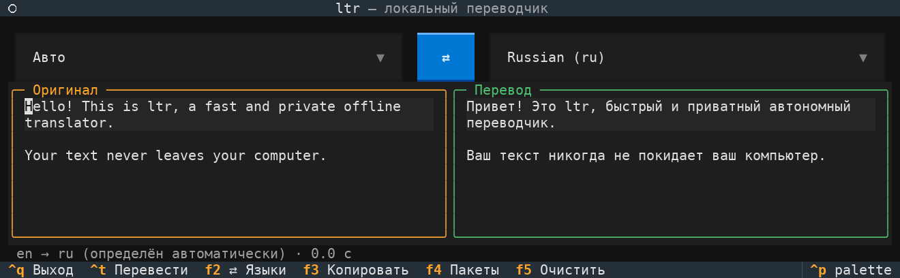
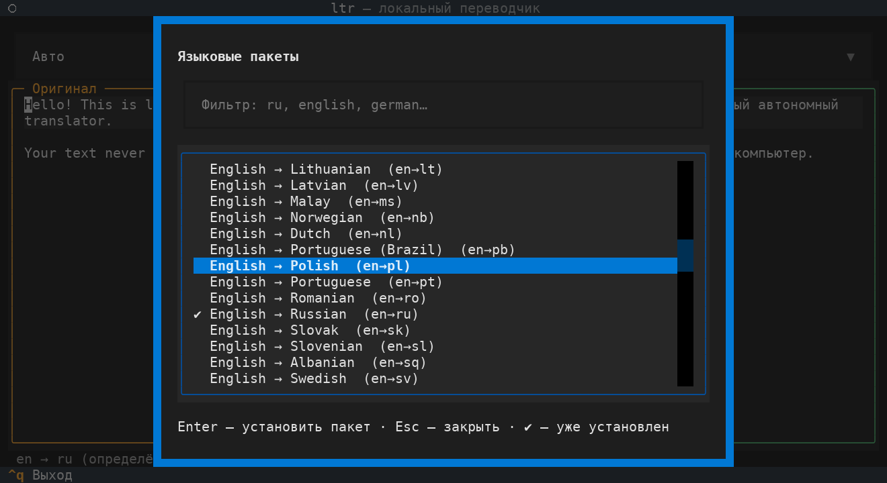

<div align="center">

# 🌐 ltr

**A fast, private, fully offline translator with a beautiful terminal UI.**

Type on the left, read the translation on the right. No accounts, no API keys, no cloud.




</div>

---

## ✨ Features

- 🔒 **100% local** – translation runs on your machine using [Argos Translate](https://github.com/argosopentech/argos-translate). Your text never leaves your computer.
- ⚡ **Live translation** – results appear automatically as you type (short debounce, no button mashing).
- 🖥️ **Clean TUI** – two-pane layout built with [Textual](https://github.com/Textualize/textual): original on the left, translation on the right.
- 🔎 **Auto language detection** – pick **Auto** as the source language and `ltr` figures out the direction for you.
- 📦 **Built-in language manager** – browse, filter and install language packages from inside the app (`F4`). No manual downloads.
- 🔁 **One-key swap** – flip languages *and* move the translation back into the input with `F2`.
- 📋 **Copy in one keystroke** – works with `wl-clipboard`, `xclip`, or directly through your terminal.
- 📥 **Paste in one keystroke** – `F6` replaces the input with the clipboard contents (needs `wl-clipboard` or `xclip`).
- 📝 **Keeps your formatting** – paragraphs and blank lines are preserved.
- 🪶 **Single file** – one Python script, easy to read, hack and install.

## 🚀 Installation

### Arch Linux

```bash
# 1. System dependencies (wl-clipboard or xclip is optional, for copy/paste)
sudo pacman -S --needed python git wl-clipboard

# 2. Get the code
git clone https://github.com/404Nick//ltr.git
cd ltr

# 3. Create an isolated environment (Arch uses PEP 668, so don't pip install system-wide)
python -m venv ~/.local/share/ltr-venv
~/.local/share/ltr-venv/bin/pip install -r requirements.txt

# 4. Install the script
install -Dm755 ltr ~/.local/bin/ltr

# 5. Point its shebang at the venv
sed -i '1s|.*|#!'"$HOME"'/.local/share/ltr-venv/bin/python|' ~/.local/bin/ltr
```

Make sure `~/.local/bin` is in your `PATH`.

> **Heads-up: the install is big.** Argos Translate depends on PyTorch (through Stanza), so the first `pip install` downloads well over a gigabyte, including CUDA libraries you won't use for CPU inference. If you don't need GPU support, install the CPU-only build of PyTorch right after creating the venv, *before* `pip install -r requirements.txt`:
>
> ```bash
> ~/.local/share/ltr-venv/bin/pip install torch --index-url https://download.pytorch.org/whl/cpu
> ```

### Other distributions

Any Linux distro with Python 3.9+ works the same way: clone the repository, create a virtual environment, run `pip install -r requirements.txt`, and start the script (`python ltr`).

## 🎮 Usage

```bash
ltr                    # open the interface
ltr "Hello, world!"    # open with some text already filled in
```

On the first launch there are no language packs yet, so the package manager opens automatically. Pick the pairs you need (for example `English → Russian` and `Russian → English`) and press <kbd>Enter</kbd> to install them. An internet connection is required **only** for this step – after that, everything works offline.



### Keybindings

| Key | Action |
| --- | --- |
| <kbd>Ctrl</kbd>+<kbd>T</kbd> | Translate immediately |
| <kbd>F2</kbd> | Swap languages (and move the translation into the input) |
| <kbd>F3</kbd> | Copy the translation to the clipboard |
| <kbd>F4</kbd> | Open the language package manager |
| <kbd>F5</kbd> | Clear both panes |
| <kbd>F6</kbd> | Paste text from the clipboard (replaces the input) |
| <kbd>Ctrl</kbd>+<kbd>Q</kbd> | Quit |

Inside the package manager: type to filter, <kbd>Enter</kbd> to install, <kbd>Esc</kbd> to close.

## 🧠 How it works

`ltr` is a thin, friendly interface on top of Argos Translate, which uses [CTranslate2](https://github.com/OpenNMT/CTranslate2) and OpenNMT models for efficient CPU inference.

- If there is no direct model between two languages, Argos automatically pivots through English (e.g. `de → en → ru`).
- Translation runs in a background thread, so the UI never freezes while you type.
- **Auto** detection is intentionally simple: text containing Cyrillic is treated as Russian, anything else as English. For other languages, choose the source language manually.

## 🛠️ Troubleshooting

**"language … is not installed"** – press <kbd>F4</kbd> and install the missing pair.

**Copy or paste doesn't work** – install `wl-clipboard` (Wayland) or `xclip` (X11). Without them, copy (<kbd>F3</kbd>) falls back to your terminal's clipboard support, which not every terminal has; paste (<kbd>F6</kbd>) has no fallback.

**The package list won't load** – the list is fetched from the internet. Check your connection and try again.

**Something else went wrong** – unexpected errors are written to `~/.cache/ltr-error.log`. Please attach it when you open an issue.

**Weird characters or broken borders** – use a terminal with a Unicode font and true-colour support (Kitty, Alacritty, WezTerm, foot, GNOME Terminal, Konsole, …).

## 🗺️ Roadmap

- [ ] English (and other) interface languages – the UI is currently in Russian
- [ ] Translation history
- [ ] Better language auto-detection
- [ ] Theme selection
- [ ] Optional higher-quality engines (NLLB, MADLAD)
- [ ] AUR package

Ideas and pull requests are welcome!

## 🤝 Contributing

1. Fork the repository
2. Create a feature branch: `git checkout -b my-feature`
3. Commit your changes and open a pull request

## 📄 License

Released under the [MIT License](LICENSE).

## 🙏 Acknowledgements

- [Argos Translate](https://github.com/argosopentech/argos-translate) – the offline translation engine
- [Textual](https://github.com/Textualize/textual) and [Rich](https://github.com/Textualize/rich) – the terminal UI framework
